# Active-Directory-Home-Lab
This repository showcases a working Active Directory setup within a home lab environment running Proxmox.

Within the environment set up:
- Domain controller, member server, and a Windows 11 client
- Setup an Organizational Unit structure, security groups, and NTFS permissions
- Create and enforce Group Policy
- Set up DHCP on the domain controller

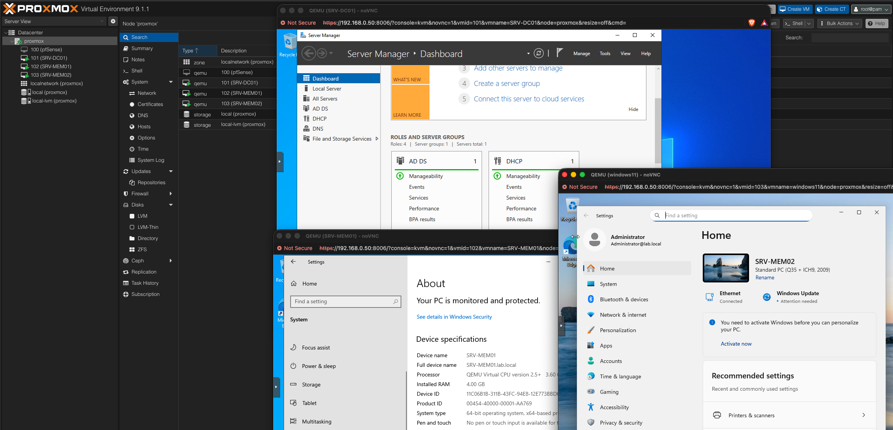

# Software Used
- Proxmox VE: hypervisor
- Windows Server 2022: Domain controller and member server
- Windows 11 Pro: workstation to mimic client
- Tools within Active Directory(Active Directory Domain Services, DNS/DHCP server roles, Group Policy)

# Features
- Windows Server 2022 domain controller on domain `lab.local` with AD DS, DNS, and DHCP
- Member server and Windows 11 client joined the domain
- Structured OU hierarchy with role based security groups
- NTFS permissions tied to group membership
- Group Policy Objects(desktop lockdown and automatic drive mapping)
- DHCP scope served on an isolated network

# Network Design
### Main Lab Network(`vmbr0`)
- Linux bridge was attached to the physical workstation's NIC, which is connected to the router. The Proxmox web UI is reached through the management IP

  
| VM | Role | IP |
|---|---|---|
| `SRV-DC01` | Domain Controller | 192.168.0.51 |
| `SRV-MEM01`| Member Server | 192.168.0.52 |
| `SRV-MEM02`| Windows 11 Pro Client | 192.168.0.53 |

### Isolated DHCP Network(`vmbr3`)
- A linux bridge intended as a purely layer 2 virtual switch
- DC01's second adapter (`LabNet`): 10.10.10.1/24, no gateway, no DNS server
- DHCP scope: 10.10.10.100 to 10.10.10.200


# Active Directory Design
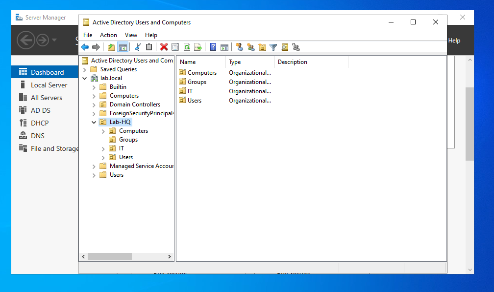
```
lab.local
└── Lab-HQ
    ├── Users
    ├── Computers
    ├── Groups
    └── IT
```
Test Account
- jsmith: a user created for this lab and intentionally aded to the IT-Support group

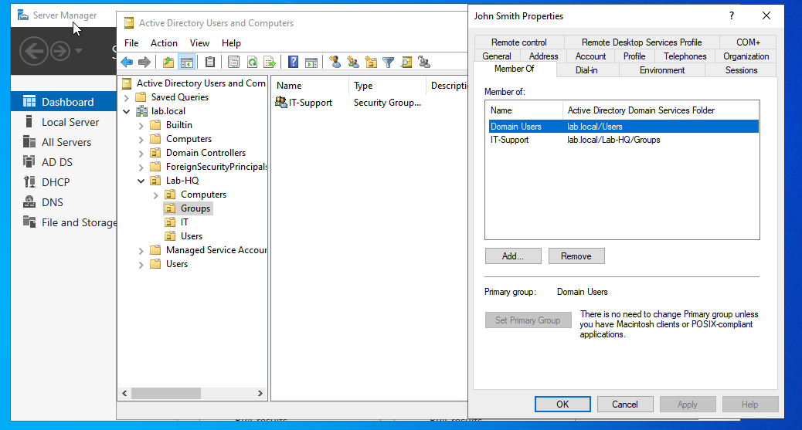

# Prerequisites
- Proxmox host with ideally 16GB RAM
- Installation media for Windows Server and Windows 11 Pro
- A regular ISP router providing the LAN and internet

# Hardware Notes
- Host: HP EliteDesk 800 G3 MT
- In general any old workstation with ideally 16GB of RAM, 256GB or greater of storage, and low to mid grade cpu should be sufficient
- A single NIC to connect workstation to Home network

# Build Walkthrough
1. Create each of the three VM's
   - SRV-DC01: use Windows Server 2022 installation media
   - SRV-MEM01: use Windows Server 2022 installation media
   - SRV-MEM02: use Windows 11 Pro installation media
  
2. Installed the AD DS role on SRV-DC01 and promoted it to a domain controller for lab.local. Set static IPs, and joined SRV-MEM01 to the domain
  
3. Organizational Units, users, groups, and NTFS Permissions
   Created the OU hierarchy, test users and security groups, then applied NTFS permissions on a shared folder so access depends on group membership

   <details>
    <summary>NTFS-security</summary>
     
   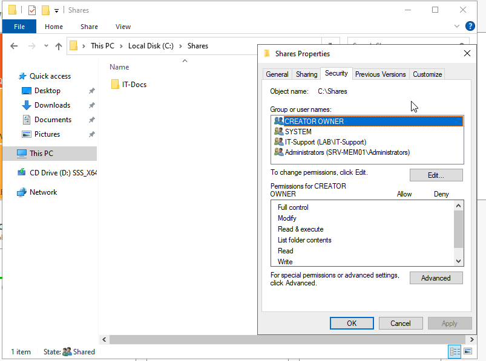
   
   </details>

   <details>
   <summary>Shared Folder Network Path</summary>

   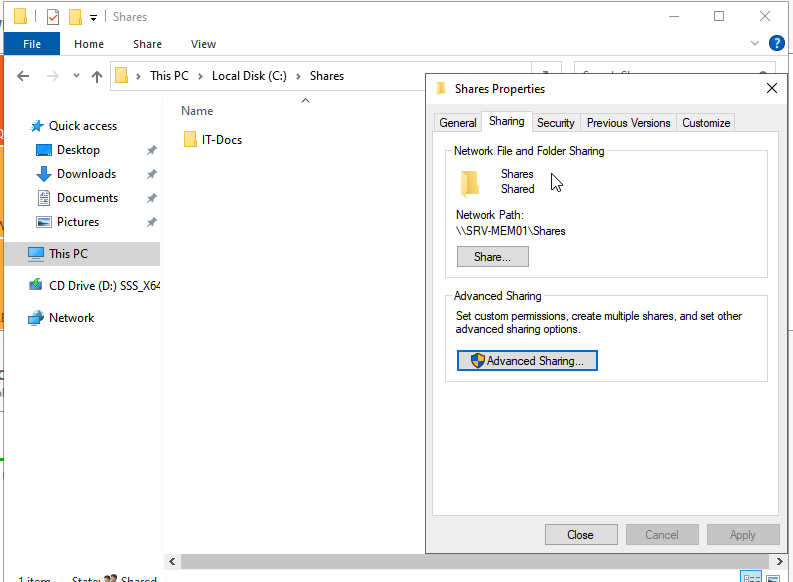

   </details>

4. Domain-joined Windows 11 client
   Joined the client vm to lab.local domain. Shows that the Active Directory works with regular client workstations

   <details>
    <summary>Windows 11 Client system information</summary>
     
   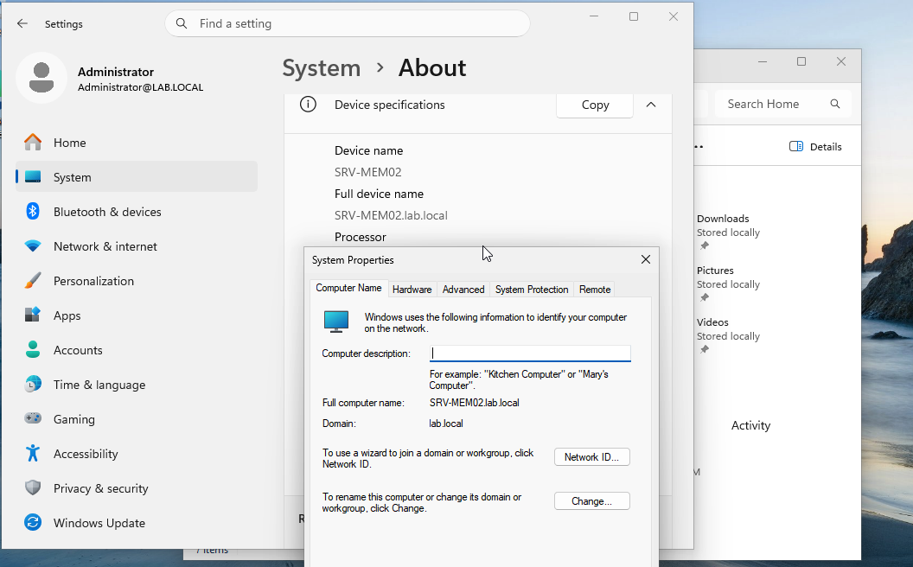
   
   </details>

   <details>
   <summary>SRV-MEM01 joined Domain</summary>

   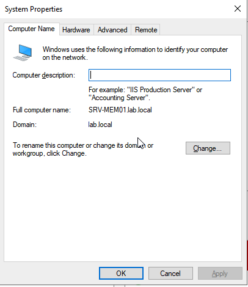

   </details>

5. Group Policy
   - IT-Desktop-Lockdown: restricts desktop options for IT users
   - IT-NetworkDrive-Map: maps Z: to \\SRV-MEM01\Shares\IT-Docs for the target OU. Verified working as jsmith

     <details>
      <summary>Group Policy Objects List</summary>
       
     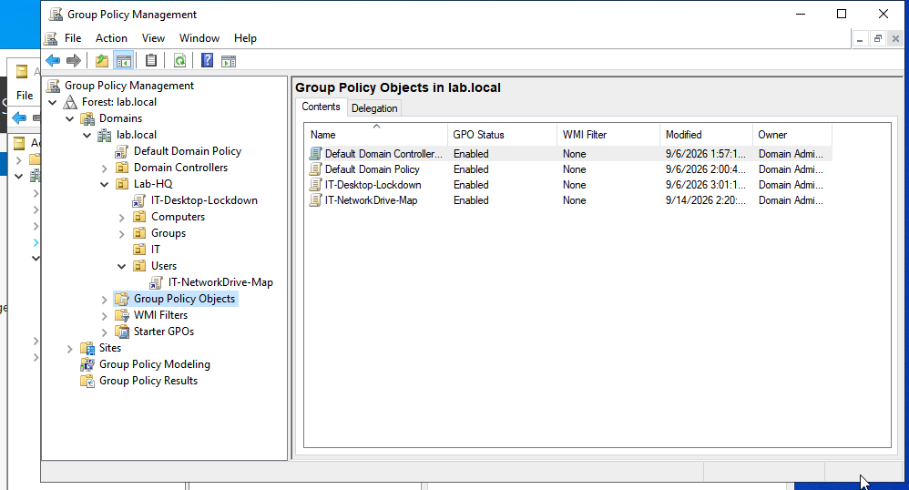
     
     </details>
  
     <details>
     <summary>Desktop Lockdown Group Policy Settings</summary>
  
     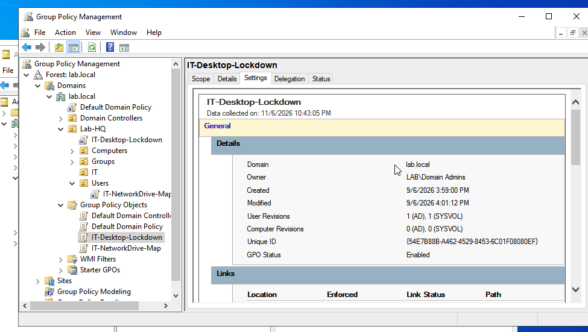
  
     </details>

6. DHCP on the domain controller
   1. Created vmbr3 in Proxmox with no bridge ports
   2. Added a second NIC(vmbr3, E1000, no firewall), to DC01 and the Win11 client
   3. Within the domain controller(DC01), renamed the new adapter to LabNet, set `10.10.10.1/24` with no gateway or DNS
   4. Installed the DHCP role, authorized it in AD, and bound it to LabNet only
   5. Created the DHCP scope
   6. Verified the Win11 client's second adapter received a 10.10.10.x ip address lease via `ipconfig /all`
  
   <details>
    <summary>DHCP Scope</summary>
     
   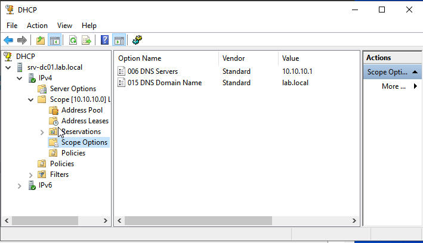
   
   </details>

   <details>
   <summary>DHCP leases</summary>

   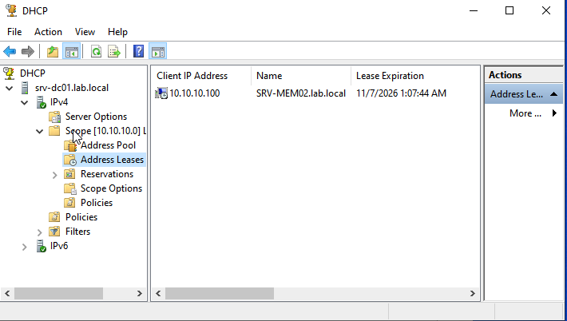

   </details>

   <details>
    <summary>DHCP pool of addresses</summary>
     
   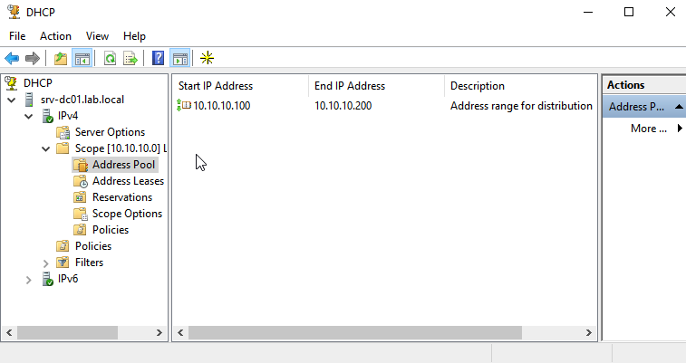
   
   </details>

   <details>
   <summary>Domain Controller network information</summary>

   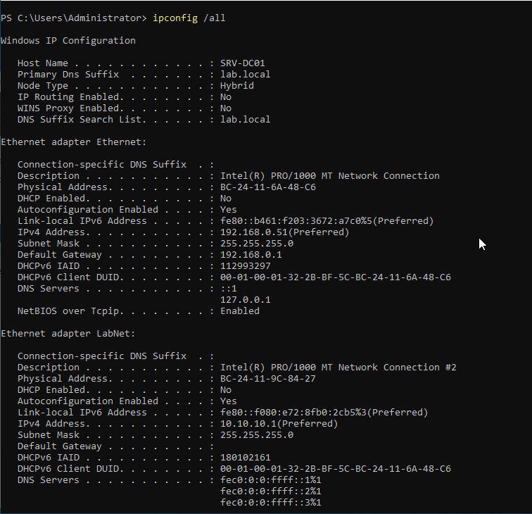

   </details>

   <details>
    <summary>Windows 11 Client network information</summary>
     
   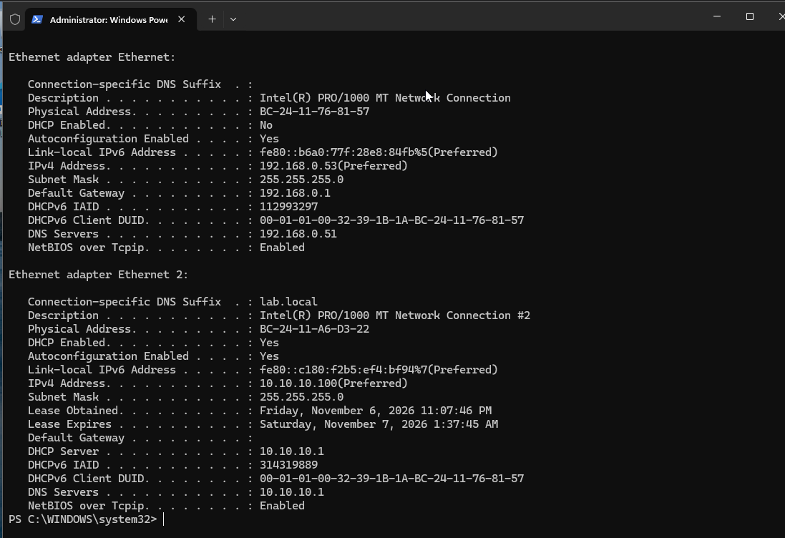
   
   </details>
